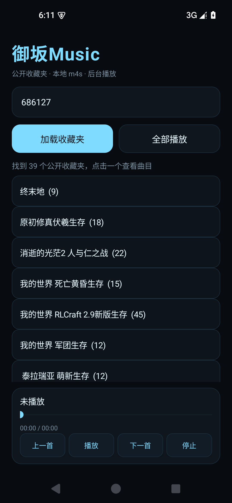
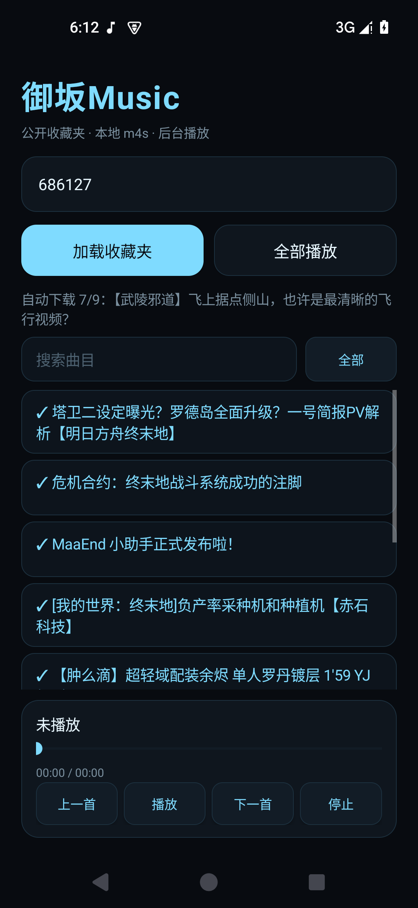
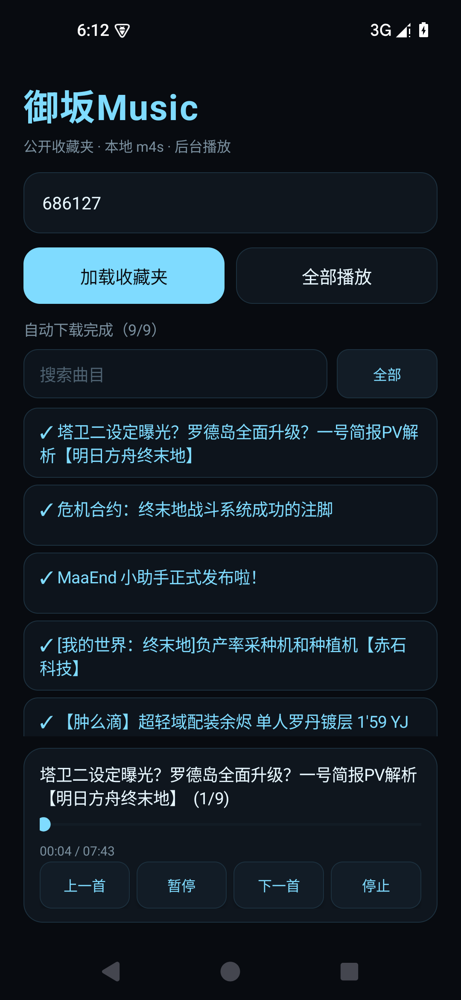
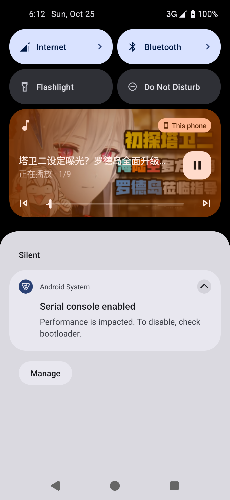

# 御坂Music

> 把 B 站公开收藏夹变成一台 Android 本地音乐播放器。

御坂Music 是一个轻量的 Android 本地播放器：输入 B 站 UID 或个人空间链接，读取**公开收藏夹**，把每个视频的音频流保存到应用私有目录，并按收藏夹顺序播放。

- 不需要登录 B 站账号
- 不读取私密收藏夹
- 不申请存储权限
- 不申请媒体库权限
- 不转码，直接播放 `.m4s`
- 所有音频保存在应用私有目录，卸载即删除

当前版本：**0.3.0**

## 截图

| 收藏夹 | 自动下载 |
|---|---|
|  |  |

| 播放队列 | 通知栏封面 |
|---|---|
|  |  |

## 功能

### 收藏夹

- 输入 UID 或 `https://space.bilibili.com/<uid>`；
- 列出该用户的公开收藏夹；
- 一个收藏夹对应一个播放列表；
- 自动分页读取全部曲目；
- 多 P 视频的每个 P 作为独立曲目。

### 自动下载

- 打开收藏夹后自动开始下载未缓存曲目；
- 已存在文件自动跳过；
- 前台下载服务 + 通知栏进度；
- 支持断点续传；
- 下载任务持久化，进程重启后继续；
- 下载失败不阻塞后续曲目；
- 下载完成不自动播放，避免突然出声。

### 播放

- 后台播放，通知栏/锁屏控制；
- 队列顺序播放，自动下一首；
- 上一首/下一首/暂停/停止；
- 进度条拖动；
- 播放队列和位置持久化，点播放可继续上次队列；
- 通知栏、锁屏、蓝牙/车机显示**视频封面**；
- 无封面时回退到应用图标，不显示空白。

### 列表

- 虚拟化 `ListView`，适合大收藏夹；
- 搜索曲目；
- 全部 / 已下载 / 未下载筛选；
- 已下载曲目显示 `✓`；
- 下载中显示 `↓`。

## 支持范围

当前只做 **Android 手机**。

不做：

- 登录/私密收藏夹；
- m4a 转换；
- 公共音乐目录/MediaStore；
- 桌面端；
- 手动歌单；
- 云同步、歌词。

## 构建

环境：

- JDK 17
- Android SDK 35
- Gradle 8.9

```bash
export JAVA_HOME=/path/to/jdk17
export ANDROID_HOME=/path/to/Android/Sdk
./gradlew assembleDebug
```

Debug APK：

```text
app/build/outputs/apk/debug/app-debug.apk
```

### Release 签名

复制 `keystore.properties.example` 为 `keystore.properties`，填入自己的 keystore：

```properties
storeFile=keystore/misaka-release.jks
storePassword=...
keyAlias=misaka
keyPassword=...
```

然后：

```bash
./gradlew assembleRelease
```

Release APK：

```text
app/build/outputs/apk/release/app-release.apk
```

`keystore.properties`、`keystore/` 已加入 `.gitignore`，不要提交。

## 数据与隐私

- 音频、封面、下载任务、播放位置都在应用私有目录；
- 不收集设备信息，不接入统计 SDK；
- 仅访问 B 站公开接口与封面/音频 CDN；
- 卸载应用会清除所有本地音频、封面和缓存；
- 没有备份/恢复功能（后续版本可加）。

## 免责声明

本项目是非官方个人项目，与哔哩哔哩（Bilibili）无关联。

- 仅用于下载/播放**公开收藏夹**中自己有权访问的内容；
- 请遵守 B 站用户协议与版权法规，不要传播下载的音频；
- 图标为同人风格素材，不代表官方角色形象；
- 使用本工具产生的任何版权或账号风险由使用者自行承担。

## 许可证

GNU General Public License v3.0，见 [LICENSE](LICENSE)。

## 发布

计划通过 GitHub Releases 发布签名 APK。发布前请确认：

1. `./gradlew assembleRelease` 通过；
2. `apksigner verify --print-certs app-release.apk` 通过；
3. 真机安装、授权通知、播放、封面、自动下载通过；
4. 备份 `keystore/misaka-release.jks` 与密码。
